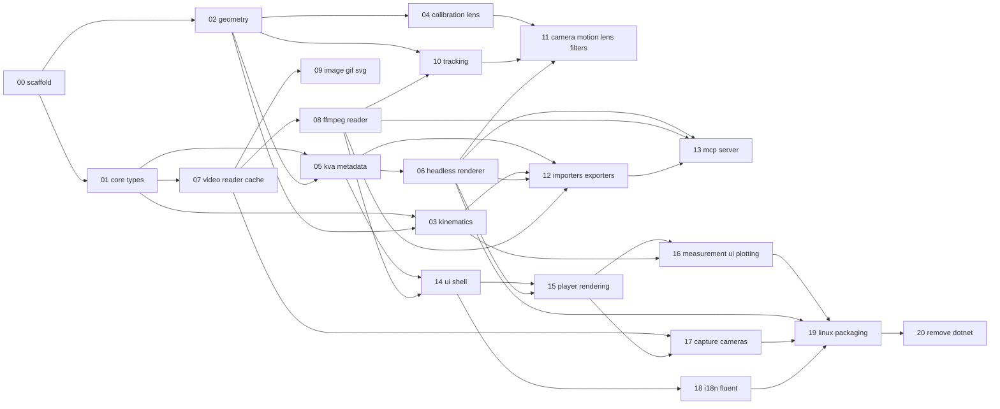

# Kinovea → Rust migration roadmap

Goal: a full Rust fork of Kinovea that builds, tests and runs on Linux, driven headlessly by an
MCP server (give it a video, it annotates skeletons and answers analysis questions) and later by
an `egui` desktop UI. Each item below is one OpenSpec change (`openspec/changes/<name>/`), done
with TDD against the parity oracle (`tests/fixtures/`, see `tests/README.md`).

Progress is tracked here: tick a change when it is archived.

## Changes

Phase A, foundations
- [x] 00 `add-rust-workspace-scaffold` (archived 2026-10-18)
- [x] 01 `add-core-types-and-units` (archived 2026-10-18)
- [x] 02 `add-geometry-core` (archived 2026-10-18)
- [x] 03 `add-kinematics-filtering` (archived 2026-10-18)
- [x] 04 `add-calibration-and-lens-distortion` (archived 2026-10-19)
- [x] 05 `add-kva-metadata-model` (archived 2026-10-18)
- [ ] 06 `add-headless-renderer`

Phase B, video
- [x] 07 `add-video-reader-and-cache` (archived 2026-10-19)
- [ ] 08 `add-ffmpeg-video-reader`
- [ ] 09 `add-image-gif-svg-readers`

Phase C, vision
- [ ] 10 `add-tracking`
- [ ] 11 `add-camera-motion-and-lens-filters`

Phase D, input/output and headless use
- [ ] 12 `add-importers-exporters`
- [ ] 13 `add-mcp-server`

Phase E, desktop UI
- [ ] 14 `add-ui-shell-vertical-slice`
- [ ] 15 `add-player-screen-rendering`
- [ ] 16 `add-measurement-ui-and-plotting`

Phase F, capture
- [ ] 17 `add-capture-pipeline-and-cameras`

Phase G, closing
- [ ] 18 `add-i18n-fluent`
- [ ] 19 `add-linux-packaging`
- [ ] 20 `remove-dotnet-solution`

## Dependencies

## Archive order constraints

- 15 modifies `ui/screen-manager`, created by 14: archive 14 before 15.
- 20 modifies `tooling/parity-oracle` and `tooling/rust-workspace`; it is archived last, after the human signs the parity checklist.

## Cross-cutting rules

- Capability paths: `<domain>/<capability>` (existing: `tooling/rust-workspace`, `tooling/parity-oracle`).
  Domains: `core`, `geometry`, `kinematics`, `measurement`, `metadata`, `render`, `video`, `tracking`,
  `io`, `mcp`, `ui`, `capture`, `i18n`, `packaging`, `tooling`.
- Crates: the workspace members fixed in 00 (`kinovea-core`, `-geometry`, `-kinematics`, `-measurement`,
  `-metadata`, `-render`, `-video`, `-tracking`, `-export`, `-fixtures`, `kinovea`). New crates (`kinovea-mcp`,
  `kinovea-ui`, `kinovea-capture`, `kinovea-i18n`, camera backends) are decisions recorded in the design of the
  change that adds them.
- Parity: every change that ports C# behavior adds cases under `tests/cases/<area>/` and, when needed, a new
  area in `Kinovea.FixtureGen`, regenerates with `tools/oracle/fixtures.sh`, and writes the Rust test against the
  fixture before the code.
- Legacy retirement: the C# solution must keep compiling until its fixtures are generated. A change deletes
  legacy C# only when the project is a leaf nothing else references (for example machine-vision camera
  plugins). Everything else is removed in `remove-dotnet-solution`. Each change lists the C# files it
  supersedes in its design so that final removal is mechanical. When a legacy directory is deleted, drop its
  entry from the linter `exclude` lists (`package.json`, `testlens.json`).
- Linux only. Windows is not a target of the Rust build.
